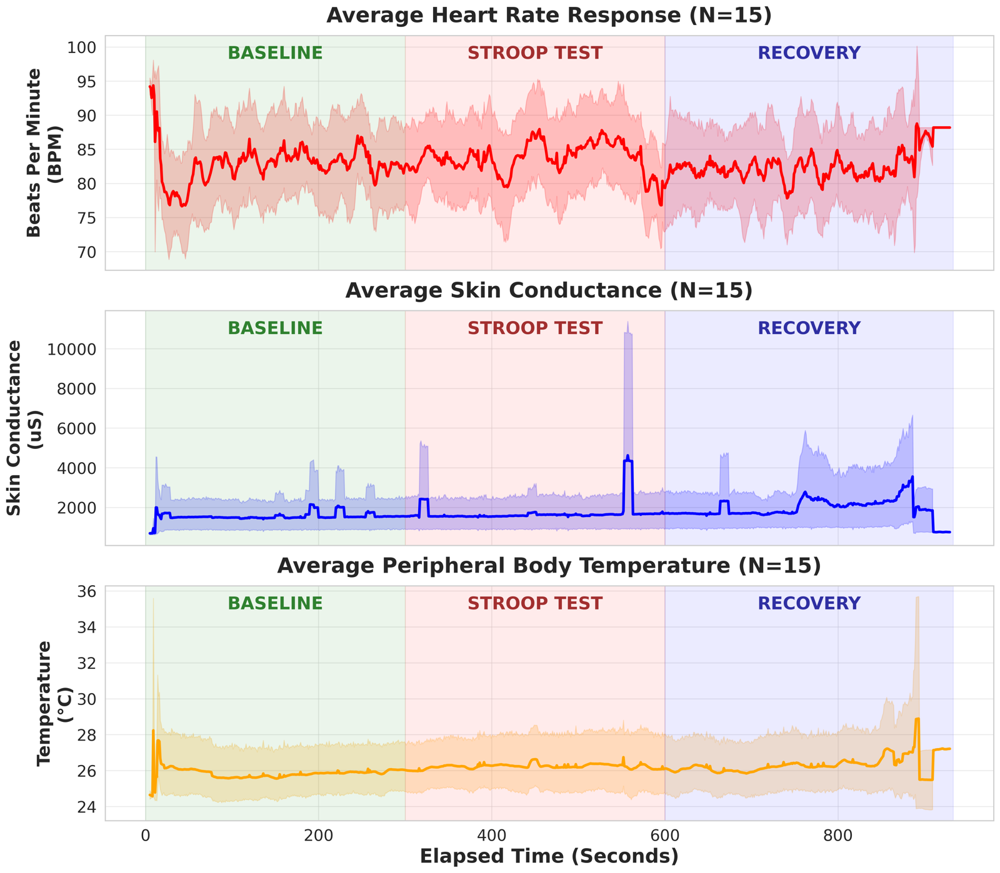
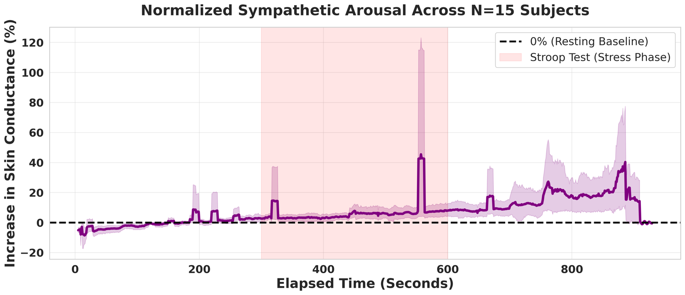
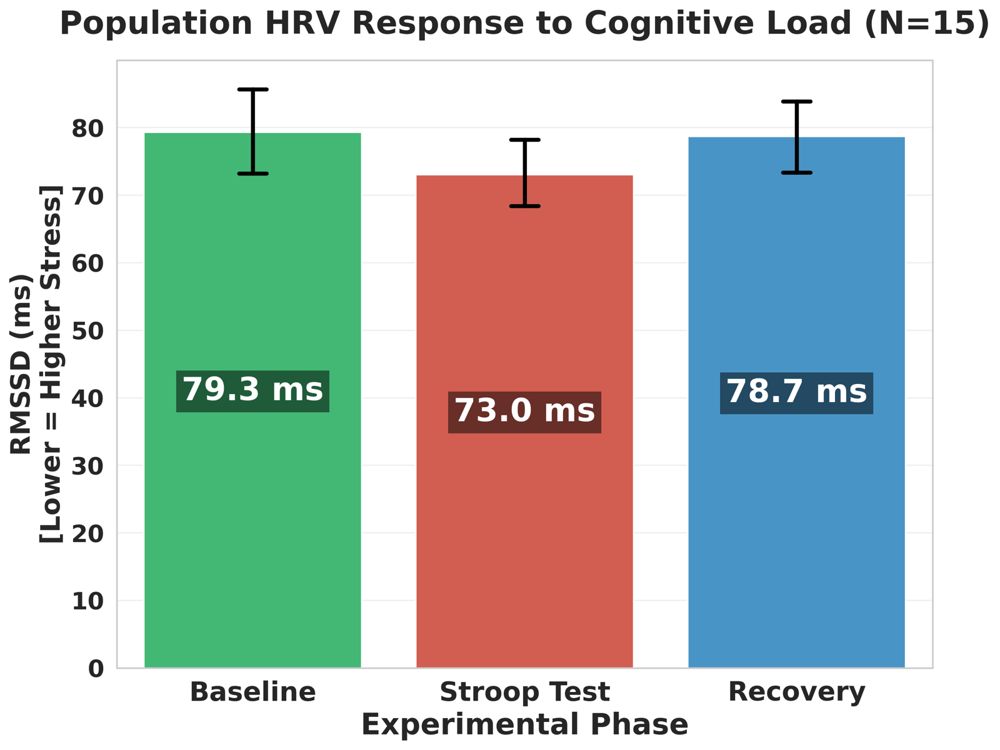
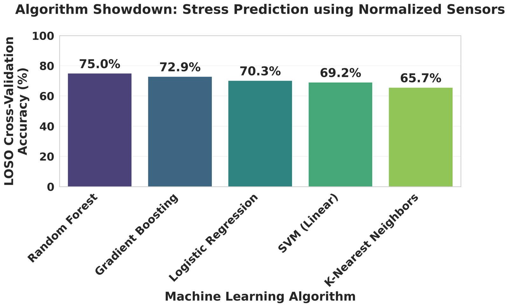
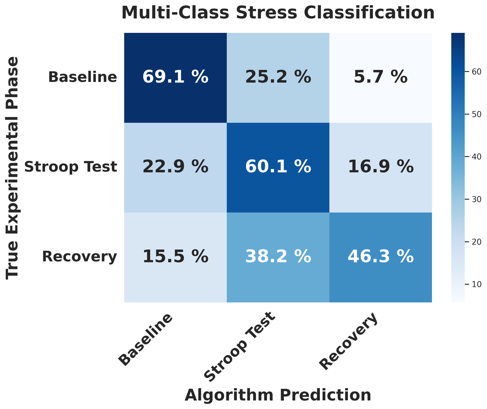

# Spondon: Low-Cost Wearable Stress Detection

Analysis code for **Spondon**, a low-cost multi-sensor wearable built from locally available components to study stress in resource-constrained countries. Using leave-one-subject-out (LOSO) evaluation, a Random Forest on baseline-normalized signals detects acute stress in **unseen participants with 75.0% accuracy**, up from 47.9% on raw signals.

> **Shahariar Ifti**, Rahat Jahangir Rony, Shuvashish Chakraborty, Asif Mahbub, Nova Ahmed. *Spondon: A Low-Cost, Multi-Sensor Wearable for Understanding Stress in Resource-Constrained Countries.* In Proceedings of ACM COMPASS 2026 (Short Paper), pp. 8–14. [doi:10.1145/3811242.3819996](https://doi.org/10.1145/3811242.3819996) (open access)

Design Inclusion and Access Lab (DIAL), North South University, Bangladesh


*Population averages (shaded: 95% CI) across Baseline, Stroop Test and Recovery (N = 15).*

## The device
An ESP32-based wearable built from off-the-shelf, locally available components for about **US$46**, compared with US$300–1,700 for commercial stress-monitoring devices. Data streams over the ESP32's Wi-Fi to a custom Android app, which logs it as CSV.

| Component | Signal |
|---|---|
| MAX30102 | Photoplethysmography (PPG) at the fingertip: heart rate and heart rate variability (RMSSD) |
| GSR sensor | Galvanic skin response (skin conductance, µS) |
| GY-906 infrared sensor | Peripheral body temperature (°C) |
| ADXL335 accelerometer | Body movement, for noise filtering |

## Study protocol
15 participants aged 18–30 wore the device through three 5-minute phases (study approved by the North South University IRB, #2025/OR-NSU/IRB/0515):

1. **Baseline** (5 min): seated rest
2. **Stroop Test** (5 min): color-word interference task to induce acute stress
3. **Recovery** (5 min): rest after the task

## Analysis pipeline
The full pipeline is in [`notebooks/spondon_stress_analysis.ipynb`](notebooks/spondon_stress_analysis.ipynb):

1. **Parsing** each participant's log into continuous sensor data and per-minute HRV summaries, with phases assigned by elapsed time
2. **Smoothing** heart rate, skin conductance and temperature with a 10-sample rolling mean
3. **Baseline normalization:** every signal expressed as percentage change from that participant's own baseline mean, removing large between-person differences in resting physiology
4. **Classification with LOSO cross-validation:** each model is trained on 14 participants and tested on the one held out, so accuracy reflects performance on people the model has never seen
5. **Model comparison:** Random Forest, Gradient Boosting, Logistic Regression, linear SVM and k-NN
6. **Rolling-window features:** 10-second standard deviation and slope of heart rate and skin conductance
7. **Three-class classification:** Baseline vs. Stroop vs. Recovery
8. **Statistics:** Wilcoxon signed-rank tests comparing each participant's Baseline and Stroop means

## Results

| Task | Features | LOSO accuracy |
|---|---|---|
| Binary (Baseline vs. Stroop) | Raw signals | 47.9% |
| Binary (Baseline vs. Stroop) | **Baseline-normalized** | **75.0%** |
| Binary (Baseline vs. Stroop) | Normalized + 10 s window features | 74.2% |
| Three-class (Baseline / Stroop / Recovery) | Normalized + 10 s window features | 58.4% (chance: 33%) |

**Normalization is the key step.** Raw signals perform at chance because resting heart rate and skin conductance vary widely between people; expressing each signal relative to the person's own baseline raises accuracy by 27 percentage points.

| Model (normalized features) | LOSO accuracy |
|---|---|
| Random Forest | 75.0% |
| Gradient Boosting | 72.9% |
| Logistic Regression | 70.3% |
| Linear SVM | 69.2% |
| k-Nearest Neighbors | 65.7% |

**Physiological response**
- **Skin conductance** rose significantly during the Stroop task (Wilcoxon, p = 0.0004) and was the most important feature for classification.
- **HRV (RMSSD)** fell from 79.3 ms at Baseline to 73.0 ms during the Stroop task (−7.9%) and returned to 78.7 ms in Recovery. The direction matches expected stress responses, but the drop was not statistically significant in this sample (p = 0.30).

<p>


</p>
<p>


</p>

## Limitations
- **Small sample:** 15 participants in a single lab session.
- **Calibration needed:** baseline normalization requires a short resting recording from each new user before stress can be detected.
- **Recovery is hard to separate:** in the three-class task, 38% of Recovery samples were classified as Stroop, consistent with skin conductance staying elevated after the task.

## Repository structure
```
notebooks/
  spondon_stress_analysis.ipynb   Full analysis pipeline
figures/                          Figures from the study (no participant identifiers)
data/README.md                    Expected format of participant data files
requirements.txt                  Python dependencies
CITATION.cff                      Citation information
```

## Running the analysis
```bash
git clone https://github.com/Sh-Ifti/spondon-stress-wearable.git
cd spondon-stress-wearable
pip install -r requirements.txt
jupyter notebook notebooks/spondon_stress_analysis.ipynb
```
Set `DATA_DIR` in the first code cell to a folder of participant CSV files in the format described in [`data/README.md`](data/README.md). The notebook also runs in Google Colab and mounts Google Drive automatically.

## Data availability
The participant data is **not** included, to protect participant privacy. Participants are referred to only by anonymous IDs (P01–P15) in the code and outputs.

## Citation
```bibtex
@inproceedings{ifti2026spondon,
  title     = {Spondon: A Low-Cost, Multi-Sensor Wearable for Understanding Stress in Resource-Constrained Countries},
  author    = {Ifti, Shahariar and Rony, Rahat Jahangir and Chakraborty, Shuvashish and Mahbub, Asif and Ahmed, Nova},
  booktitle = {Proceedings of the 2026 ACM SIGCAS/SIGCHI Conference on Computing and Sustainable Societies (COMPASS '26)},
  pages     = {8--14},
  year      = {2026},
  doi       = {10.1145/3811242.3819996}
}
```

## License
Code is released under the MIT License (see `LICENSE`).
